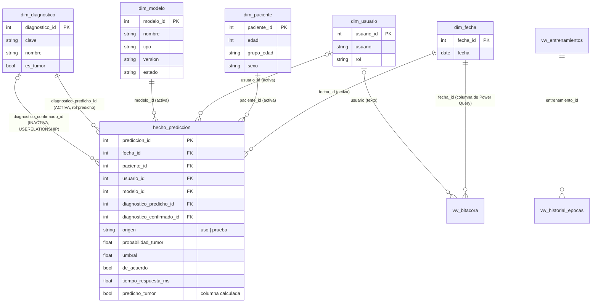

# Guía de Power BI · Sistema de apoyo para detección de tumores cerebrales

Esta guía explica cómo armar el tablero de Power BI sobre la base del sistema: cómo conectarse,
qué relaciones crear, qué medidas DAX escribir, qué valores deben dar y qué páginas construir.
El archivo `.pbix` lo construye el equipo en Power BI Desktop; aquí solo están las instrucciones.

> **Aviso.** Resultado de apoyo. No sustituye el diagnóstico de un médico especialista.
> El tablero describe el desempeño de un proyecto académico; no es un dispositivo médico.

> **Importante: el DAX de esta guía no se ejecutó.** En el equipo de desarrollo no hay Power BI
> Desktop, así que **no se pudo ejecutar ninguna medida DAX**. Para cada medida se escribió su
> equivalente exacto en SQL y en pandas en `tablero/comprobar_medidas.py`, se corrió sobre la base
> local (`app/almacen/tumores.db`, abierta en modo de solo lectura) y los dos cálculos coincidieron.
> Los **valores esperados** de la sección 5 salen de esa corrida. Si en Power BI una medida da otro
> número con los mismos datos y el mismo filtro, la medida está mal escrita o el modelo está mal
> relacionado.

## Contenido
1. [Qué se importa](#1-qué-se-importa)
2. [Conexión](#2-conexión)
3. [Modelo estrella: relaciones](#3-modelo-estrella-relaciones)
4. [Medidas DAX](#4-medidas-dax)
5. [Comprobación y valores esperados](#5-comprobación-y-valores-esperados)
6. [Propuesta de 4 páginas](#6-propuesta-de-4-páginas)
7. [Publicar el tablero y obtener `POWERBI_URL`](#7-publicar-el-tablero-y-obtener-powerbi_url)

---

## 1. Qué se importa

La base tiene el mismo esquema en Fabric (`sql/01_crear_tablas.sql`) y en SQLite
(`app/backend/tablas.py`). El detalle de cada columna está en `datos/diccionario_datos.md`.

| Objeto en la base | Nombre en Power BI | Para qué | Columnas que **no** se cargan |
|---|---|---|---|
| `hecho_prediccion` (tabla) | `hecho_prediccion` | Hecho: una fila por imagen clasificada | `archivo_imagen`, `archivo_gradcam` |
| `dim_fecha` (tabla) | `dim_fecha` | Calendario 2025-01-01 a 2027-12-31 | — |
| `dim_diagnostico` (tabla) | `dim_diagnostico` | 5 claves de diagnóstico; dos roles | — |
| `vw_modelos` (vista) | `dim_modelo` | Versiones de modelo y su estado | — |
| `dim_usuario` (vista) | `dim_usuario` | Usuarios sin el hash de contraseña | — |
| `dim_paciente` (tabla) | `dim_paciente` | Edad, grupo de edad y sexo (ficticios) | **`identificador`** |
| `vw_bitacora` (vista) | `vw_bitacora` | Actividad de usuarios (sin IP) | — |
| `vw_entrenamientos` (vista) | `vw_entrenamientos` | Entrenamientos de la red | — |
| `vw_historial_epocas` (vista) | `vw_historial_epocas` | Curvas por época | — |
| `vw_metricas_pliegue` (vista) | `vw_metricas_pliegue` | Métricas de la validación cruzada | — |

**Recomendación: importar las vistas de lectura** siempre que existan (`dim_usuario`, `vw_modelos`,
`vw_bitacora`, `vw_entrenamientos`, `vw_historial_epocas`, `vw_metricas_pliegue`). Ya vienen sin
hashes, sin IP y sin identificadores de paciente.

**Excepción necesaria:** las vistas de lectura no incluyen las llaves del hecho. `vw_predicciones`
es una vista **plana** (ya trae la fecha, el modelo, el diagnóstico predicho y el confirmado como
texto, más las columnas `acierto`, `falso_negativo` y `falso_positivo`), pero no trae
`fecha_id`, `modelo_id` ni los `diagnostico_*_id`. Para armar el modelo estrella con relaciones
hay que importar las tablas `hecho_prediccion`, `dim_fecha`, `dim_diagnostico` y `dim_paciente`,
quitando en Power Query las columnas marcadas arriba. **Nunca importe `usuarios` (tiene
`hash_password`) ni `sesiones`.**

> `vw_predicciones` sirve como alternativa rápida de una sola tabla (sin relaciones) si no hay
> tiempo de armar el modelo estrella. Las medidas de esta guía están escritas para el modelo
> estrella.

Modo de almacenamiento: **Importar** (no DirectQuery). Los volúmenes son pequeños (3,603 filas en
el hecho al momento de esta guía) y así las medidas y la publicación son más sencillas.

---

## 2. Conexión

### 2.1 SQL database de Microsoft Fabric (opción principal)

> La base de Fabric **ya está creada y cargada** (21 de noviembre de 2026, con
> `scripts/probar_fabric.py`): 3,600 predicciones de prueba, 5 modelos y la corrida de v001. La
> conexión de **Power BI Desktop** a esa base sigue los pasos estándar de SQL Server con Microsoft
> Entra ID; hágala con la misma cuenta del área de trabajo.
>
> En Fabric solo hay filas `origen = "uso"` de los estudios que se hagan en la demostración, así
> que los valores de las secciones 5.3 a 5.5 (uso y bitácora) serán distintos; los de **prueba
> (sección 5.1) deben coincidir exactamente**.

1. (Ya hecho.) El esquema se crea con `sql/01_crear_tablas.sql` y los datos se cargan con
   `scripts/probar_fabric.py` o `sql/02_cargar_datos.py` usando `DB_MODO=fabric` (ver el `README.md`).
2. En Fabric, abra la SQL database y copie de su configuración (**Cadenas de conexión**) el
   **servidor** (termina en `.database.fabric.microsoft.com`, con puerto `1433`) y el **nombre de
   la base**. Son los mismos valores de `FABRIC_SERVIDOR` y `FABRIC_BASE` en `.env`. Esta guía no
   los incluye porque los da el usuario.
3. En Power BI Desktop: **Inicio › Obtener datos › Base de datos de SQL Server**.
   - **Servidor:** el valor copiado.
   - **Base de datos:** el nombre copiado.
   - **Modo de conectividad de datos:** Importar.
4. Cuando pida credenciales, elija **Cuenta de Microsoft** (Microsoft Entra ID) e inicie sesión con
   la cuenta que tiene acceso al área de trabajo de Fabric. No use autenticación de SQL Server ni
   de Windows: Fabric acepta solo Microsoft Entra ID.
5. En el navegador marque los objetos de la [sección 1](#1-qué-se-importa) y elija
   **Transformar datos** para quitar las columnas que no se cargan:
   - `dim_paciente`: quitar `identificador`.
   - `hecho_prediccion`: quitar `archivo_imagen` y `archivo_gradcam`.
   - Renombrar la consulta `vw_modelos` como `dim_modelo`.
6. Revise los tipos: `de_acuerdo`, `es_tumor`, `activo` y `exito` deben ser **Verdadero/Falso**
   (en SQL Server son `BIT`); `fecha` de `dim_fecha` debe ser **Fecha**; `creado_en` y
   `fecha_hora`, **Fecha y hora**.

### 2.2 Base SQLite local (plan B)

Hay dos caminos. **Se recomienda el de CSV**, porque no requiere instalar nada más.

**Opción B1 (recomendada): exportar a CSV.** El script `tablero/exportar_csv.py` abre la base
**en modo de solo lectura** y escribe un CSV por tabla o vista en `tablero/csv/` (UTF-8 con BOM,
para que los acentos se lean bien). Ya omite `identificador`, las rutas de imagen, `usuarios` y
`sesiones`, y escribe las columnas lógicas como `TRUE`/`FALSE`.

```powershell
.venv\Scripts\python.exe tablero\exportar_csv.py
```

Corrida real (21 de noviembre de 2026, 04:54):

| Archivo | Filas |
|---|---|
| `hecho_prediccion.csv` | 3,603 |
| `dim_paciente.csv` | 1 |
| `dim_fecha.csv` | 1,095 |
| `dim_usuario.csv` | 3 |
| `dim_modelo.csv` | 5 |
| `dim_diagnostico.csv` | 5 |
| `vw_predicciones.csv` | 3,603 |
| `vw_bitacora.csv` | 16 |
| `vw_entrenamientos.csv` | 1 |
| `vw_metricas_pliegue.csv` | 25 |
| `vw_historial_epocas.csv` | 28 |

En Power BI Desktop: **Obtener datos › Texto/CSV**, un archivo a la vez (o **Carpeta** apuntando
a `tablero/csv/`). Origen del archivo: **65001: Unicode (UTF-8)**; delimitador: coma. Revise los
tipos igual que en el paso 6 de la sección 2.1. Para actualizar el tablero, vuelva a correr el
script y pulse **Actualizar** en Power BI.

> `tablero/csv/` es una copia de la base del momento de la exportación. Contiene solo datos
> ficticios y de prueba, pero aun así no se recomienda subirla a GitHub.

**Opción B2: ODBC de SQLite.** Requiere instalar un controlador ODBC de SQLite de 64 bits
(por ejemplo, el de Christian Werner, "SQLite3 ODBC Driver"); **no viene instalado en este
equipo**. Después: crear un DSN de sistema que apunte a `app\almacen\tumores.db`, y en Power BI
**Obtener datos › ODBC** con ese DSN. Con ODBC, las columnas lógicas llegan como números 0/1:
cámbielas a Verdadero/Falso en Power Query. No abra la base mientras el servidor de la aplicación
escribe en ella si el controlador no permite modo de solo lectura.

### 2.3 Columna `fecha_id` para la bitácora (Power Query)

`vw_bitacora` no trae `fecha_id`. Para relacionarla con `dim_fecha`, agregue en Power Query
(consulta `vw_bitacora` › **Agregar columna › Columna personalizada**, o en el editor avanzado):

```powerquery
= Table.AddColumn(#"Paso anterior", "fecha_id",
    each Date.Year([fecha_hora]) * 10000 + Date.Month([fecha_hora]) * 100 + Date.Day([fecha_hora]),
    Int64.Type)
```

(Sustituya `#"Paso anterior"` por el nombre del último paso de la consulta.)

---

## 3. Modelo estrella: relaciones

Cree las relaciones en **Vista de modelo** y desactive la detección automática
(**Archivo › Opciones › Carga de datos › Relaciones**) para que Power BI no invente otras.

| # | Desde (muchos) | Hacia (uno) | Cardinalidad | Dirección del filtro | Estado |
|---|---|---|---|---|---|
| 1 | `hecho_prediccion[fecha_id]` | `dim_fecha[fecha_id]` | Varios a uno (*:1) | Única (de la dimensión al hecho) | Activa |
| 2 | `hecho_prediccion[paciente_id]` | `dim_paciente[paciente_id]` | *:1 | Única | Activa |
| 3 | `hecho_prediccion[usuario_id]` | `dim_usuario[usuario_id]` | *:1 | Única | Activa |
| 4 | `hecho_prediccion[modelo_id]` | `dim_modelo[modelo_id]` | *:1 | Única | Activa |
| 5 | `hecho_prediccion[diagnostico_predicho_id]` | `dim_diagnostico[diagnostico_id]` | *:1 | Única | **Activa** (rol "predicho") |
| 6 | `hecho_prediccion[diagnostico_confirmado_id]` | `dim_diagnostico[diagnostico_id]` | *:1 | Única | **Inactiva** (rol "confirmado") |
| 7 | `vw_bitacora[fecha_id]` | `dim_fecha[fecha_id]` | *:1 | Única | Activa |
| 8 | `vw_bitacora[usuario]` | `dim_usuario[usuario]` | *:1 | Única | Activa |
| 9 | `vw_historial_epocas[entrenamiento_id]` | `vw_entrenamientos[entrenamiento_id]` | *:1 | Única | Activa |

Notas:
- `paciente_id` y `usuario_id` están vacíos en las filas de prueba (`origen = "prueba"`); en
  Power BI esas filas caen en la fila "(En blanco)" de la dimensión. Es lo esperado.
- La relación 8 usa el nombre de usuario porque `vw_bitacora` no trae `usuario_id`. Los intentos
  de inicio de sesión con un usuario que no existe quedan en "(En blanco)".
- `vw_metricas_pliegue` se deja **sin relación**: los modelos clásicos no tienen
  `entrenamiento_id` y el nombre del modelo se repite entre versiones de la red. Use sus propias
  columnas (`modelo`, `modelo_version`, `pliegue`) en los visuales.
- Todas las relaciones son de filtro **único**. No use filtro bidireccional: no hace falta y
  produce ambigüedad con los dos roles de `dim_diagnostico`.

### 3.1 Los dos roles de `dim_diagnostico`

Un estudio tiene un diagnóstico **predicho** por el modelo (`tumor` o `sin_tumor`) y, cuando el
doctor lo revisa, un diagnóstico **confirmado** (cualquiera de las 5 claves). Power BI solo permite
una relación activa entre dos tablas, así que:
- la relación **predicho** queda **activa**: cualquier visual que use `dim_diagnostico` filtra por
  lo que dijo el modelo;
- la relación **confirmado** queda **inactiva** y se activa dentro de las medidas que la necesitan
  con `USERELATIONSHIP` (verdaderos positivos, falsos negativos, etc., y
  `Estudios por diagnóstico confirmado`).

Para cruzar los dos roles en un mismo cálculo se agrega una **columna calculada** en
`hecho_prediccion` que guarda el rol predicho:

```dax
predicho_tumor = RELATED ( dim_diagnostico[es_tumor] )
```

`RELATED` usa la relación activa (la del predicho). Dentro de las medidas de la matriz de
confusión, `USERELATIONSHIP` activa la del confirmado, de modo que el filtro sobre
`dim_diagnostico[es_tumor]` se aplica al confirmado y `predicho_tumor` aporta el predicho.

> **Cuidado con las segmentaciones de `dim_diagnostico`.** Dentro de una medida con
> `USERELATIONSHIP`, una segmentación sobre `dim_diagnostico` filtra el diagnóstico
> **confirmado**, no el predicho. En las páginas de desempeño no ponga segmentaciones de
> `dim_diagnostico`; si quiere filtrar por lo que dijo el modelo use `hecho_prediccion[predicho_tumor]`.

### 3.2 `dim_fecha` como tabla de fechas

1. Seleccione `dim_fecha` › **Herramientas de tabla › Marcar como tabla de fechas**.
2. Columna de fecha: `dim_fecha[fecha]` (tipo Fecha, sin repetidos y sin huecos: 1,095 días del
   2025-01-01 al 2027-12-31).
3. Ordene `nombre_mes` por `mes` (**Herramientas de columnas › Ordenar por columna**). Para
   `dia_semana`, cree una columna con el número del día si quiere ordenarlo de lunes a domingo.

La relación usa `fecha_id` (entero AAAAMMDD), no la columna de fecha. Las medidas de esta guía no
usan inteligencia de tiempo; si agrega alguna (`DATESYTD`, `SAMEPERIODLASTYEAR`), incluya
`REMOVEFILTERS ( dim_fecha )` en el `CALCULATE` para que se comporte como con una relación por fecha.

**Qué fecha es cada una:** `hecho_prediccion.fecha_id` es la **fecha del estudio** que captura el
doctor; `creado_en` es cuándo se subió. En las filas de prueba, `fecha_id` es la fecha de la corrida
que generó los resultados (21 de noviembre de 2026). Las horas son la hora local del servidor.

### 3.3 Diagrama



Todas las relaciones filtran en una sola dirección: de la dimensión hacia el hecho (o hacia
`vw_bitacora` y `vw_historial_epocas`).

---

## 4. Medidas DAX

Cree una tabla vacía para guardar las medidas (**Inicio › Especificar datos**, nómbrela
`Medidas`) y escriba ahí todas las siguientes. Formatos sugeridos: porcentajes con 2 decimales,
sensibilidad/especificidad/precisión como número con 4 decimales (así se comparan con
`resultados/`), conteos como entero.

### 4.1 `origen = "prueba"` contra `origen = "uso"`

`hecho_prediccion` mezcla dos cosas distintas que **nunca deben sumarse sin querer**:

| `origen` | Qué es | Filas hoy | Diagnóstico confirmado | `de_acuerdo` | Tiempo de respuesta |
|---|---|---|---|---|---|
| `"prueba"` | Resultados de los 5 modelos sobre las **720 imágenes de prueba** (5 × 720 = 3,600 filas), cargados por `sql/02_cargar_datos.py` | 3,600 | La clase real del dataset | La carga lo llena con **acierto del modelo** (no es la opinión de un doctor) | Vacío |
| `"uso"` | Estudios subidos por los doctores en la aplicación | 3 | El que captura el doctor (vacío si está pendiente) | Opinión del doctor | Medido por la app |

Reglas de las medidas:
- Las medidas de desempeño (sensibilidad, especificidad, etc.) son **neutras**: respetan el
  filtro de `origen` que tenga la página o el visual. En la página de comparación de modelos, fije
  `origen = "prueba"` como **filtro de página**; en la de uso real, `origen = "uso"`.
- Las medidas propias del uso real (**tasa de desacuerdo** y **tiempo de respuesta**) fuerzan
  `origen = "uso"` con `KEEPFILTERS`: así, en una página filtrada a prueba devuelven **en blanco**
  en lugar de mezclar los aciertos de la carga de prueba con la opinión de los doctores.
- Sin filtro de origen ni de modelo, una tarjeta de sensibilidad sumaría los 5 modelos de prueba
  más el uso real. Eso no tiene interpretación: **ponga siempre un filtro de modelo y de origen**
  en los visuales de desempeño.

### 4.2 Columna calculada (en `hecho_prediccion`)

```dax
predicho_tumor = RELATED ( dim_diagnostico[es_tumor] )
```
Verdadero si el modelo dijo "tumor". Usa la relación activa (rol predicho).

### 4.3 Conteos

```dax
Total de estudios =
COUNTROWS ( hecho_prediccion )
```
Cuenta las filas del hecho con los filtros vigentes. Cada fila es una imagen clasificada.

```dax
Estudios de uso =
CALCULATE ( [Total de estudios], KEEPFILTERS ( hecho_prediccion[origen] = "uso" ) )
```

```dax
Estudios de prueba =
CALCULATE ( [Total de estudios], KEEPFILTERS ( hecho_prediccion[origen] = "prueba" ) )
```

```dax
% de estudios de uso =
DIVIDE ( [Estudios de uso], [Total de estudios] )
```
Estudios de uso real contra prueba. `KEEPFILTERS` hace que el filtro se **intersecte** con el que
ya tenga el visual (en lugar de reemplazarlo).

```dax
Estudios con tumor detectado =
CALCULATE ( [Total de estudios], KEEPFILTERS ( hecho_prediccion[predicho_tumor] = TRUE () ) )
```

```dax
% con tumor detectado =
DIVIDE ( [Estudios con tumor detectado], [Total de estudios] )
```
Proporción de imágenes en las que el modelo respondió "Se detecta posible tumor". No dice si
acertó: para eso están las medidas siguientes.

```dax
Estudios confirmados =
CALCULATE (
    [Total de estudios],
    KEEPFILTERS ( NOT ISBLANK ( hecho_prediccion[diagnostico_confirmado_id] ) )
)
```

```dax
Estudios por diagnóstico confirmado =
CALCULATE (
    [Total de estudios],
    USERELATIONSHIP ( hecho_prediccion[diagnostico_confirmado_id], dim_diagnostico[diagnostico_id] )
)
```
Para un visual que agrupa por `dim_diagnostico[nombre]` según el diagnóstico **confirmado**
(el rol inactivo). Con `[Total de estudios]` el mismo visual agrupa por el **predicho**.

### 4.4 Matriz de confusión

Tumor es la clase positiva. Solo cuentan los estudios con diagnóstico confirmado.

```dax
Verdaderos positivos =
CALCULATE (
    COUNTROWS ( hecho_prediccion ),
    USERELATIONSHIP ( hecho_prediccion[diagnostico_confirmado_id], dim_diagnostico[diagnostico_id] ),
    dim_diagnostico[es_tumor] == TRUE (),
    hecho_prediccion[predicho_tumor] == TRUE ()
)
```

```dax
Verdaderos negativos =
CALCULATE (
    COUNTROWS ( hecho_prediccion ),
    USERELATIONSHIP ( hecho_prediccion[diagnostico_confirmado_id], dim_diagnostico[diagnostico_id] ),
    dim_diagnostico[es_tumor] == FALSE (),
    hecho_prediccion[predicho_tumor] == FALSE ()
)
```

```dax
Falsos negativos =
CALCULATE (
    COUNTROWS ( hecho_prediccion ),
    USERELATIONSHIP ( hecho_prediccion[diagnostico_confirmado_id], dim_diagnostico[diagnostico_id] ),
    dim_diagnostico[es_tumor] == TRUE (),
    hecho_prediccion[predicho_tumor] == FALSE ()
)
```
**El error más costoso:** había tumor confirmado y el modelo dijo "sin tumor".

```dax
Falsos positivos =
CALCULATE (
    COUNTROWS ( hecho_prediccion ),
    USERELATIONSHIP ( hecho_prediccion[diagnostico_confirmado_id], dim_diagnostico[diagnostico_id] ),
    dim_diagnostico[es_tumor] == FALSE (),
    hecho_prediccion[predicho_tumor] == TRUE ()
)
```
El modelo dijo "tumor" y el diagnóstico confirmado es "sin tumor".

Por qué así:
- `USERELATIONSHIP` activa la relación del **confirmado** solo dentro de la medida; el filtro sobre
  `dim_diagnostico[es_tumor]` se aplica entonces al diagnóstico confirmado.
- Se usa `==` (igualdad estricta) y no `=`. En DAX, `BLANK () = FALSE ()` es **verdadero**: con `=`,
  los estudios **pendientes de confirmar** (confirmado en blanco) se contarían como "sin tumor" y
  inflarían los verdaderos negativos y los falsos positivos. Con `==` quedan fuera.

### 4.5 Métricas de desempeño

```dax
Sensibilidad =
DIVIDE ( [Verdaderos positivos], [Verdaderos positivos] + [Falsos negativos] )
```
De los tumores confirmados, qué proporción detectó el modelo. **Métrica principal del proyecto**
(objetivo 0.98). En blanco si no hay tumores confirmados.

```dax
Especificidad =
DIVIDE ( [Verdaderos negativos], [Verdaderos negativos] + [Falsos positivos] )
```
De los casos sin tumor confirmados, qué proporción el modelo dejó como "sin tumor". En prueba se
mide con solo 73 imágenes "sin tumor": cada falso positivo la mueve 1.4 puntos porcentuales.

```dax
Precisión =
DIVIDE ( [Verdaderos positivos], [Verdaderos positivos] + [Falsos positivos] )
```
De las veces que el modelo dijo "tumor", qué proporción se confirmó como tumor.

### 4.6 Medidas del uso real

```dax
Tasa de desacuerdo del doctor =
VAR respondidos =
    CALCULATE (
        COUNTROWS ( hecho_prediccion ),
        KEEPFILTERS ( hecho_prediccion[origen] = "uso" ),
        KEEPFILTERS ( NOT ISBLANK ( hecho_prediccion[de_acuerdo] ) )
    )
VAR desacuerdos =
    CALCULATE (
        COUNTROWS ( hecho_prediccion ),
        KEEPFILTERS ( hecho_prediccion[origen] = "uso" ),
        KEEPFILTERS ( hecho_prediccion[de_acuerdo] == FALSE () )
    )
RETURN
    DIVIDE ( desacuerdos, respondidos )
```
De los estudios reales que el doctor ya revisó, en qué proporción dijo que **no** está de acuerdo
con el sistema. Los pendientes (en blanco) no cuentan. Forzado a `origen = "uso"` porque en las
filas de prueba `de_acuerdo` es el acierto del modelo, no la opinión de un doctor.

```dax
Tiempo promedio de respuesta (ms) =
CALCULATE (
    AVERAGE ( hecho_prediccion[tiempo_respuesta_ms] ),
    KEEPFILTERS ( hecho_prediccion[origen] = "uso" )
)
```
Milisegundos que tardó el servidor en clasificar cada imagen (incluye el Grad-CAM). Las filas de
prueba no tienen tiempo.

### 4.7 Comparación entre versiones del modelo

```dax
Sensibilidad (producción) =
CALCULATE (
    [Sensibilidad],
    REMOVEFILTERS ( dim_modelo ),
    dim_modelo[tipo] = "red_keras",
    dim_modelo[estado] = "produccion"
)
```
La sensibilidad de la red en producción con los **mismos** filtros de origen, fecha, etc., sin
importar qué modelo esté seleccionado.

```dax
Diferencia de sensibilidad vs. producción =
VAR s = [Sensibilidad]
RETURN
    IF ( NOT ISBLANK ( s ), s - [Sensibilidad (producción)] )
```
Positiva: el modelo de la fila detecta más tumores que el de producción; negativa: menos. Úsela en
una tabla con `dim_modelo[nombre]` y `dim_modelo[version]` y el filtro de página
`origen = "prueba"`.

> **Límite de esta comparación.** Solo los 5 modelos originales tienen filas de prueba. Un
> **candidato** reentrenado desde la aplicación **nunca se evalúa en prueba** (ver
> `app/backend/DESVIACIONES_CONTRATO.md`); sus métricas están en `dim_modelo[sensibilidad]`,
> `dim_modelo[especificidad]`, etc., con `dim_modelo[origen_metricas] = "validacion"`. Para
> compararlo, muestre esas columnas en una tabla aparte y no las mezcle con las de prueba.

### 4.8 Actividad de usuarios (sobre `vw_bitacora`)

```dax
Eventos de bitácora = COUNTROWS ( vw_bitacora )
```

```dax
Inicios de sesión correctos =
CALCULATE ( [Eventos de bitácora], KEEPFILTERS ( vw_bitacora[accion] = "LOGIN_OK" ) )
```

```dax
Inicios de sesión fallidos =
CALCULATE ( [Eventos de bitácora], KEEPFILTERS ( vw_bitacora[accion] = "LOGIN_FALLIDO" ) )
```

```dax
Accesos denegados =
CALCULATE ( [Eventos de bitácora], KEEPFILTERS ( vw_bitacora[accion] = "ACCESO_DENEGADO" ) )
```

```dax
Eventos sin éxito =
CALCULATE ( [Eventos de bitácora], KEEPFILTERS ( vw_bitacora[exito] == FALSE () ) )
```

```dax
Usuarios activos =
CALCULATE ( COUNTROWS ( dim_usuario ), KEEPFILTERS ( dim_usuario[activo] == TRUE () ) )
```

---

## 5. Comprobación y valores esperados

**No se pudo ejecutar DAX: no hay Power BI en esta máquina.** Lo que sí se hizo:

1. `tablero/comprobar_medidas.py` calcula cada medida con **SQL** (consulta parametrizada sobre las
   tablas) y con **pandas** (misma lógica que el DAX: columna `predicho_tumor` por la relación
   activa, rol confirmado para la matriz de confusión, `KEEPFILTERS` de `origen = "uso"`).
2. Compara los dos resultados entre sí y, para la prueba, contra `resultados/prueba_resumen.csv`.
3. Se corrió el **21 de noviembre de 2026 a las 04:54** sobre `app/almacen/tumores.db` en modo de
   solo lectura. Resultado: **todas las comprobaciones coinciden** (código de salida 0).

```powershell
.venv\Scripts\python.exe tablero\comprobar_medidas.py
```

> Los valores de **prueba** son estables: solo cambian si se vuelven a correr los notebooks y la
> carga. Los de **uso** y **bitácora** cambian cada vez que alguien usa la aplicación (al momento
> de la corrida había 3 estudios de uso). Si la base cambió, vuelva a correr el script: sus
> números son los que debe dar Power BI.

### 5.1 Filtro `origen = "prueba"`, un modelo a la vez

Visual: tabla con `dim_modelo[nombre]` en filas, filtro de página `hecho_prediccion[origen] = "prueba"`.

| Medida | Logística (rasgos básicos) | Logística (MobileNetV2) | Random Forest (MobileNetV2) | SVM RBF (MobileNetV2) | **Red Keras (MobileNetV2) v001** |
|---|---|---|---|---|---|
| Total de estudios | 720 | 720 | 720 | 720 | 720 |
| % con tumor detectado | 0.9486 | 0.8931 | 0.9042 | 0.8931 | 0.8806 |
| Sensibilidad | 0.9768 | 0.9784 | 0.9830 | 0.9784 | **0.9675** |
| Especificidad | 0.3014 | 0.8630 | 0.7945 | 0.8630 | 0.8904 |
| Falsos negativos | 15 | 14 | 11 | 14 | **21** |
| Falsos positivos | 51 | 10 | 15 | 10 | 8 |
| Precisión | 0.9253 | 0.9844 | 0.9770 | 0.9844 | 0.9874 |
| Tasa de desacuerdo del doctor | (en blanco) | (en blanco) | (en blanco) | (en blanco) | (en blanco) |
| Tiempo promedio de respuesta (ms) | (en blanco) | (en blanco) | (en blanco) | (en blanco) | (en blanco) |
| Diferencia de sensibilidad vs. producción | +0.0093 | +0.0108 | +0.0155 | +0.0108 | 0.0000 |

Sensibilidad, especificidad, falsos negativos, falsos positivos, precisión y total coinciden con
`resultados/prueba_resumen.csv` para los 5 modelos (la red: sensibilidad 0.9675 y 21 falsos
negativos). La tasa de desacuerdo y el tiempo dan en blanco **a propósito** (sección 4.6).

Comprobación del rol inactivo: `Estudios por diagnóstico confirmado` para la red en prueba, por
`dim_diagnostico[clave]`: glioma 291, meningioma 164, pituitary 192, sin_tumor 73 (total 720).

### 5.2 Filtro `origen = "prueba"` sin segmentar por modelo

Solo para comprobar que el modelo está bien armado; **no lo muestre en el tablero** (suma los 5
modelos). Total 3,600; % con tumor detectado 0.9039; sensibilidad 0.9768; especificidad 0.7425;
falsos negativos 75; falsos positivos 94; precisión 0.9711.

### 5.3 Filtro `origen = "uso"`

| Medida | Valor esperado (corrida del 21/11/2026 04:54) |
|---|---|
| Total de estudios | 3 |
| % con tumor detectado | 0.6667 |
| Sensibilidad | 1.0000 |
| Especificidad | 0.5000 |
| Falsos negativos | 0 |
| Falsos positivos | 1 |
| Precisión | 0.5000 |
| Tasa de desacuerdo del doctor | 0.3333 |
| Tiempo promedio de respuesta (ms) | 1,995.5 |

Los 3 estudios son de prueba del sistema (un solo paciente ficticio, `doctor1`, red v001) y los 3
están confirmados. Con 3 estudios estas métricas no tienen ningún valor estadístico; solo sirven
para verificar que las medidas funcionan.

### 5.4 Sin filtro de origen

| Medida | Valor esperado |
|---|---|
| Total de estudios | 3,603 |
| Estudios de uso | 3 |
| Estudios de prueba | 3,600 |
| % de estudios de uso | 0.0008 (0.08 %) |

### 5.5 Actividad de usuarios (sin filtros)

| Medida | Valor esperado |
|---|---|
| Eventos de bitácora | 16 |
| Inicios de sesión correctos | 3 |
| Inicios de sesión fallidos | 2 |
| Accesos denegados | 1 |
| Eventos sin éxito | 3 |
| Usuarios activos | 3 |

Eventos por acción: ACCESO_DENEGADO 1, CARGA_DATOS 3, ESTUDIO_CONFIRMADO 3, ESTUDIO_CREADO 3,
LOGIN_FALLIDO 2, LOGIN_OK 3, LOGOUT 1.

---

## 6. Propuesta de 4 páginas

La historia: **qué hace el sistema → qué modelo es mejor y por qué → cómo le va en el uso real →
quién lo usa y si es seguro.**

### Página 1 · Resumen

- **Objetivo:** dar en 10 segundos el estado del sistema.
- **Visuales:**
  - Tarjetas: `[Estudios de uso]`, `[% con tumor detectado]` (con filtro visual `origen = "uso"`),
    `[Tasa de desacuerdo del doctor]`, `[Tiempo promedio de respuesta (ms)]`.
  - Tarjeta de varias filas "Modelo en producción": `dim_modelo[nombre]`, `dim_modelo[version]`,
    `dim_modelo[umbral]` con filtro visual `dim_modelo[estado] = "produccion"`.
  - Tarjetas de prueba de la red en producción (filtro visual `origen = "prueba"` y
    `estado = "produccion"`): `[Sensibilidad]` (0.9675) y `[Falsos negativos]` (21), con el
    objetivo 0.98 como texto o línea de referencia.
  - Gráfico de columnas: `[Estudios de uso]` por `dim_fecha[fecha]` (o por semana).
  - Gráfico de anillo: `[Estudios con tumor detectado]` contra el resto, filtro `origen = "uso"`.
- **Segmentaciones:** `dim_fecha[fecha]` (intervalo).
- **Mensaje:** "El sistema está en uso con la red v001; en prueba detecta 96.75 % de los tumores,
  por debajo del objetivo de 98 %. Es una herramienta de apoyo."

### Página 2 · Comparación de modelos

- **Objetivo:** mostrar con honestidad qué modelo detecta más tumores y con qué costo.
- **Filtro de página:** `hecho_prediccion[origen] = "prueba"`.
- **Visuales:**
  - Tabla: `dim_modelo[nombre]`, `dim_modelo[version]`, `dim_modelo[estado]`, `[Sensibilidad]`,
    `[Especificidad]`, `[Precisión]`, `[Falsos negativos]`, `[Falsos positivos]`,
    `[Diferencia de sensibilidad vs. producción]`. Formato condicional: sensibilidad < 0.98 en
    ámbar; diferencia positiva en verde.
  - Gráfico de barras: `[Falsos negativos]` por `dim_modelo[nombre]` (el error más costoso).
  - Gráfico de dispersión: eje X `[Especificidad]`, eje Y `[Sensibilidad]`, detalle
    `dim_modelo[nombre]`, con una línea de referencia en Y = 0.98.
  - Matriz de confusión del modelo elegido: matriz con `hecho_prediccion[predicho_tumor]` en
    filas y las medidas `[Verdaderos positivos]`, `[Falsos negativos]`, `[Falsos positivos]`,
    `[Verdaderos negativos]` como valores (o cuatro tarjetas).
  - Gráfico de líneas desde `vw_metricas_pliegue`: `sensibilidad` y `especificidad` por
    `pliegue`, leyenda `modelo` (variación entre pliegues de la validación cruzada).
  - Cuadro de texto con la nota: "En prueba solo hay 73 imágenes sin tumor; las diferencias de
    especificidad deben leerse con cautela. Red contra SVM: McNemar p = 0.227 (sin diferencia
    significativa)."
- **Segmentaciones:** `dim_modelo[nombre]` (para la matriz de confusión), `dim_modelo[tipo]`.
- **Mensaje:** "Solo Random Forest alcanza la sensibilidad objetivo en prueba (0.9830, 11 falsos
  negativos). La red en producción tiene la mayor especificidad, pero 21 falsos negativos."

### Página 3 · Desempeño en uso real

- **Objetivo:** vigilar cómo responde el sistema con estudios reales y qué opinan los doctores.
- **Filtro de página:** `hecho_prediccion[origen] = "uso"`.
- **Visuales:**
  - Tarjetas: `[Estudios de uso]`, `[Estudios confirmados]`, `[Tasa de desacuerdo del doctor]`,
    `[Falsos negativos]`, `[Falsos positivos]`.
  - Gráfico de líneas: `[Tasa de desacuerdo del doctor]` y `[Sensibilidad]` por `dim_fecha[semana]`.
  - Columnas agrupadas: `[Estudios por diagnóstico confirmado]` por `dim_diagnostico[nombre]`
    (rol confirmado) junto a `[Total de estudios]` por `dim_diagnostico[nombre]` (rol predicho).
  - Histograma de `hecho_prediccion[probabilidad_tumor]` (gráfico de columnas sobre grupos de
    0.1) con una línea en el umbral vigente.
  - Barras: `[Total de estudios]` por `dim_paciente[grupo_edad]` y por `dim_paciente[sexo]`.
  - Tarjeta: `[Tiempo promedio de respuesta (ms)]`.
- **Segmentaciones:** `dim_fecha[fecha]`, `dim_usuario[usuario]` (doctor), `dim_modelo[version]`.
- **Mensaje:** "Cuántos estudios llegan, cuántos ya revisó un doctor y en cuántos no estuvo de
  acuerdo. Un aumento de desacuerdos o de falsos negativos confirmados es la señal para revisar el
  modelo." (Con 3 estudios de uso, esta página todavía no permite conclusiones.)

### Página 4 · Actividad de usuarios

- **Objetivo:** auditar quién usa el sistema y detectar accesos indebidos.
- **Visuales:**
  - Tarjetas: `[Inicios de sesión correctos]`, `[Inicios de sesión fallidos]`,
    `[Accesos denegados]`, `[Usuarios activos]`.
  - Columnas apiladas: `[Eventos de bitácora]` por `dim_fecha[fecha]`, leyenda `vw_bitacora[accion]`.
  - Barras: `[Eventos de bitácora]` por `vw_bitacora[usuario]` y `vw_bitacora[rol]`.
  - Tabla: `vw_bitacora[fecha_hora]`, `usuario`, `rol`, `accion`, `exito`, `detalle`, ordenada
    por fecha descendente (formato condicional en rojo para `exito = Falso`).
  - Tabla de entrenamientos desde `vw_entrenamientos`: `version`, `estado`, `mejor_epoca`,
    `diagnostico`, `solicitado_por`, `terminado_en`.
  - Gráfico de líneas desde `vw_historial_epocas`: `perdida` y `perdida_val` por `epoca`, con
    segmentación de `etapa` (`cabeza`, `ajuste_fino`). Muestra la convergencia (mejor época 12 en
    la cabeza de v001).
- **Segmentaciones:** `dim_fecha[fecha]`, `vw_bitacora[accion]`, `dim_usuario[rol]`.
- **Mensaje:** "Quién entra, qué hace y qué intentos fallaron. Los accesos denegados muestran que
  los permisos se validan en el servidor."

### Nota de diseño (todas las páginas)

- **Pie de página fijo en cada página** (cuadro de texto): *"Resultado de apoyo. No sustituye el
  diagnóstico de un médico especialista."*
- **Nada de identificadores de paciente:** no se importa `dim_paciente[identificador]` ni las rutas
  de imágenes. Solo se muestran edad, grupo de edad y sexo, siempre agregados.
- El Grad-CAM, si se menciona, se llama **"zona que más influyó"**, nunca "ubicación del tumor".
- Se recomienda un solo color de alerta (ámbar o rojo) para falsos negativos y sensibilidad por
  debajo de 0.98, y textos en español en títulos y ejes.
- Cada visual de desempeño debe mostrar en su título qué origen y qué modelo está midiendo.

---

## 7. Publicar el tablero y obtener `POWERBI_URL`

El panel del Administrador (sección **Tablero Power BI**) muestra en un `iframe` la dirección que
esté en `POWERBI_URL` dentro de `.env`. La aplicación solo acepta direcciones que empiecen con
`https://`; después de cambiarla hay que **reiniciar el servidor**.

1. En Power BI Desktop: **Inicio › Publicar** y elija el área de trabajo (requiere una cuenta de
   Power BI de la organización).
2. Si los datos vienen de Fabric, en el servicio de Power BI configure las credenciales del modelo
   semántico (**Configuración › Credenciales del origen de datos › OAuth2 / Microsoft Entra ID**)
   para poder actualizarlo. Si vienen de CSV locales, la actualización programada necesita una
   puerta de enlace (gateway); para la demostración basta con volver a publicar.
3. Obtenga la liga, con una de estas dos opciones:

| Opción | Cómo | Quién puede verlo | Cuándo usarla |
|---|---|---|---|
| **Insertar en sitio web o portal** (recomendada) | En el informe: **Archivo › Insertar informe › Sitio web o portal**. Copie el vínculo `https://app.powerbi.com/reportEmbed?...` | Solo usuarios con sesión en Power BI y permiso sobre el informe | Siempre que sea posible |
| **Publicar en la web** | **Archivo › Insertar informe › Publicar en la web (público)**. Copie el vínculo | **Cualquier persona de internet** que tenga la liga, sin iniciar sesión | Solo con datos totalmente ficticios y si el administrador del inquilino lo permite |

4. En `.env`: `POWERBI_URL=<vínculo copiado>` y reinicie el servidor.

> **Advertencia de privacidad.** "Publicar en la web" deja el informe **público en internet**,
> sin control de acceso, y los buscadores pueden indexarlo. No lo use con datos de pacientes
> reales ni con nada que identifique a una persona. Aunque este proyecto usa pacientes ficticios,
> la opción recomendada es **Insertar en sitio web o portal**, que exige iniciar sesión. Muchas
> organizaciones tienen "Publicar en la web" desactivado por política.

Fecha de esta guía: 21 de noviembre de 2026.
